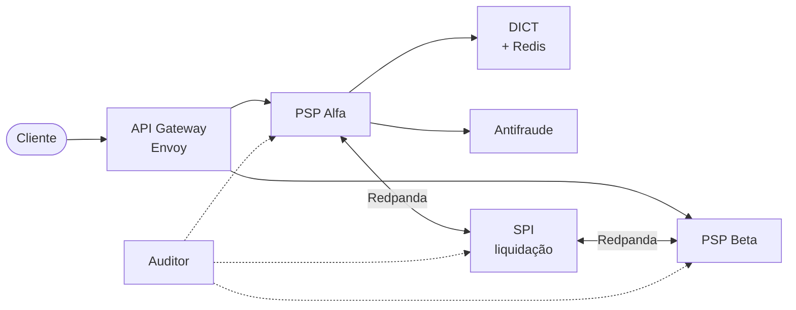

# Urubu do Pix

Pagamentos instantâneos distribuídos, inspirados no Pix. O "urubu do Pix" é o golpe que promete multiplicar o dinheiro enviado; aqui é o contrário: nenhum centavo é criado ou perdido, mesmo com falhas.

Projeto final de **Engenharia de Sistemas Distribuídos 2026.2**.

> **Status:** Projeto 02 (documentação inicial). Arquitetura documentada (C4, ADRs, stack e padrões), ambiente completo no Docker Compose e pipeline de CI. Os serviços sobem, se conectam às dependências e expõem saúde e métricas; as regras de negócio entram no Projeto 03.

## O problema

Um pagamento instantâneo atravessa pelo menos três participantes independentes (banco pagador, liquidante central e banco recebedor), cada um com o próprio banco de dados. Ele precisa terminar em segundos e manter a soma dos saldos intacta mesmo com quedas de serviço, timeouts, partições de rede e mensagens repetidas. Como não existe transação distribuída entre instituições, essa garantia tem de vir da arquitetura.

## Arquitetura

| Documento | Conteúdo |
|---|---|
| [C4 nível 1: contexto](docs/arquitetura/c4-contexto.md) | O sistema, quem o usa e com o que ele se relaciona |
| [C4 nível 2: containers](docs/arquitetura/c4-containers.md) | Serviços, bancos, mensageria, redes e o fluxo de um pagamento |
| [ADRs](docs/adr/README.md) | 5 decisões: SAGA + Outbox, mensageria, Zero Trust, DevSecOps, auditor |
| [Stack](docs/arquitetura/stack.md) | Cada tecnologia, por que foi escolhida e o que foi descartado |
| [Padrões](docs/arquitetura/padroes.md) | 12 padrões arquiteturais e onde cada um é aplicado |
| [Plano de testes](docs/testes/plano-de-testes.md) | Como cada critério de sucesso (C1 a C7) será validado |



| Serviço | Responsabilidade |
|---|---|
| `psp` | Banco simulado: contas de clientes, débito, crédito, Outbox e Inbox. Uma instância por banco (Alfa `10000001`, Beta `20000002`). |
| `spi` | Liquidação atômica entre contas de reserva; orquestra a SAGA do pagamento. |
| `dict` | Diretório de chaves Pix, com cache e limite contra varredura de chaves. |
| `antifraude` | Score de risco de cada pagamento; sem estado. |
| `auditor` | Verifica os invariantes (conservação de saldo e idempotência) ao fim de cada teste. |

A proposta aprovada no Projeto 01 está em [docs/proposta](docs/proposta/proposta-projeto-01.md) ([PDF](docs/proposta/proposta-projeto-01.pdf)).

## Equipe

| Integrante | GitHub | Contato |
|---|---|---|
| Deivison Costa | [@Deivison-Costaa](https://github.com/Deivison-Costaa) | *a preencher* |
| Giancarlo Silveira Cavalcante | [@GianBala](https://github.com/GianBala) | *a preencher* |
| Herlan Alef de Lima Nascimento | [@HerlanLima](https://github.com/HerlanLima) | *a preencher* |

### Divisão de responsabilidades

| Integrante | Frente |
|---|---|
| Deivison Costa | Liquidação (SPI), observabilidade e coordenação |
| Giancarlo Silveira Cavalcante | Bancos (PSP), mensageria e qualidade (auditor, testes) |
| Herlan Alef de Lima Nascimento | Borda, segurança e entrega (gateway, DICT, antifraude, CI/CD) |

A equipe começou com cinco integrantes e ficou com três em novembro de 2026; as frentes foram redistribuídas. O que cada um entregou e assume no Projeto 03: [docs/equipe/responsabilidades.md](docs/equipe/responsabilidades.md).

## Entregas

| Entrega | Conteúdo | Data | Peso | Status |
|---|---|---|---|---|
| Projeto 01 | Grupo, tema, proposta e repositório | 09/10/2026 | 10% | entregue |
| Projeto 02 | C4 (níveis 1 e 2), ADRs iniciais, stack, padrões, Docker Compose, CI e apresentação | 06/11/2026 | 20% | entregue |
| Projeto 03 | Código e testes, documentação final e apresentação presencial | 11/12/2026 | 70% | |

## Estrutura do repositório

```
cmd/                 ponto de entrada de cada serviço (psp, spi, dict, antifraude, auditor)
internal/
  dominio/           regras de domínio puras: valor em centavos, EndToEndId, chave Pix
  plataforma/        base comum: config, servidor HTTP, saúde, métricas, conexões
deploy/
  docker/            Dockerfile único (distroless) para todos os serviços
  envoy/             configuração do API Gateway
  postgres/          esquema e dados iniciais de cada banco
  redpanda/          criação dos tópicos e DLQs
  prometheus/, grafana/
scripts/fumaca.sh    teste de fumaça do ambiente
docs/                arquitetura, ADRs, testes, equipe, apresentação, proposta e registro de IA
.github/             pipeline de CI e Dependabot
```

## Como executar

Requisitos: Docker com Compose v2. Para rodar os testes fora do Docker: Go 1.26.

```bash
cp .env.example .env                    # credenciais locais (não versionado)
docker compose up -d --build --wait     # sobe tudo e espera os healthchecks
./scripts/fumaca.sh                     # verifica o ambiente
```

Se a porta 8080 estiver ocupada, troque `GATEWAY_PORTA` no `.env` (o script de fumaça lê a mesma variável: `GATEWAY_PORTA=18080 ./scripts/fumaca.sh`).

| Endereço | O quê |
|---|---|
| `http://localhost:8080/psp/alfa/readyz` | Prontidão do Banco Alfa, pelo gateway |
| `http://localhost:8080/psp/beta/` | Nome e versão do serviço do Banco Beta |
| `localhost:19092` | Redpanda (API Kafka), para inspecionar tópicos |

Observabilidade (opcional):

```bash
docker compose --profile observabilidade up -d
# Prometheus: http://127.0.0.1:9090   Grafana: http://127.0.0.1:3000 (admin / GRAFANA_ADMIN_PASSWORD do .env)
```

Testes e lint:

```bash
go test -race -cover ./...
golangci-lint run ./...                 # v2.15
```

Para derrubar e apagar os dados: `docker compose --profile observabilidade down -v`.

## Integração contínua

O workflow [`ci.yml`](.github/workflows/ci.yml) roda em todo push e PR para a `main`: testes com detector de corrida e cobertura, lint, govulncheck, Trivy (repositório e imagens), SBOM de cada imagem e o teste de fumaça com o ambiente completo. Na `main` do repositório oficial, as imagens são publicadas no GHCR e assinadas com Cosign. Detalhes e motivos: [ADR-0004](docs/adr/0004-pipeline-devsecops.md).

## Convenções

- Commits no formato Conventional Commits (`feat:`, `fix:`, `docs:`, `test:` etc.).
- Cada integrante commita o próprio trabalho: a avaliação individual usa o histórico de commits.

## Ferramentas de IA utilizadas

> Seção obrigatória pelo enunciado; sem ela a entrega é desclassificada. O registro detalhado, entrada por entrada, fica em [docs/ia/registro.md](docs/ia/registro.md).

| Ferramenta | Onde atuou | Como foi orientada | Avaliação |
|---|---|---|---|
| Claude Code (modelo Claude Opus 5.5) | Projeto 01: análise do enunciado, sugestão de temas, redação da proposta e do README inicial | PDF do enunciado e pedido de ideias complexas alinhadas aos critérios de avaliação | Tema escolhido entre cinco sugestões; as outras quatro foram descartadas. O nome do projeto foi definido pela equipe. |
| Claude Code (modelo Claude Opus 5.5) | Projeto 02: rascunho do código-base (plataforma comum, tipos de domínio, esqueletos dos serviços), testes unitários, Docker Compose, configuração do Envoy, pipeline de CI, diagramas C4, ADRs, stack, padrões, plano de testes e roteiro da apresentação | Enunciado, proposta aprovada e as regras do grupo: testes antes do código, dinheiro só em inteiros, versões fixadas, imagens mínimas, nenhuma credencial no repositório. Tudo foi executado e verificado localmente (testes, lint, scanners e ambiente completo) antes de ir para o repositório | Cada integrante revisou e enviou a parte da sua frente. Ajustes feitos durante a verificação: ordem dos middlewares (métrica de erro 500 não era contada), teste de segmentação de rede que passava sem testar nada (trocado por `pg_isready` com controle positivo), porta do gateway configurável. Revisão de cada frente: ver registro |
