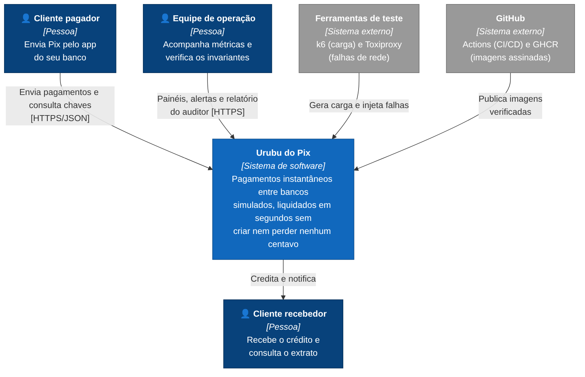
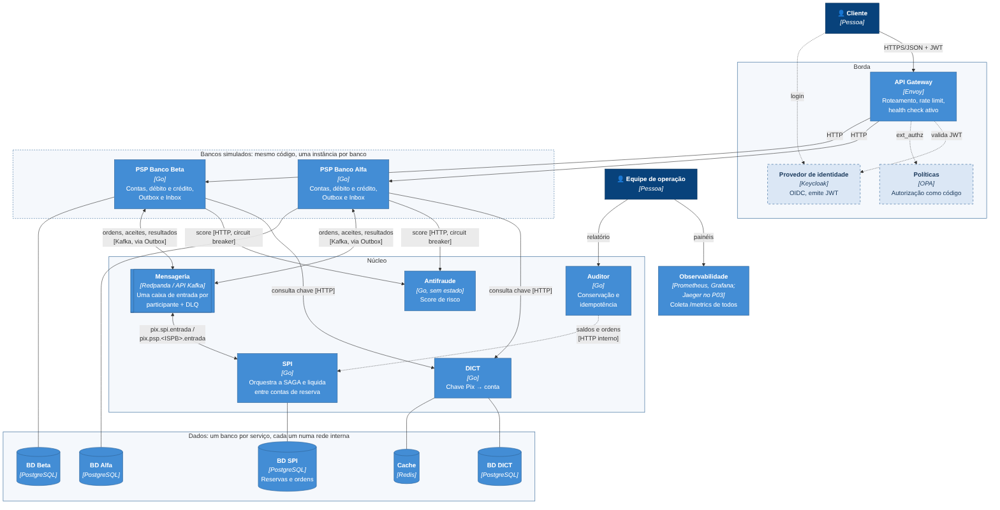
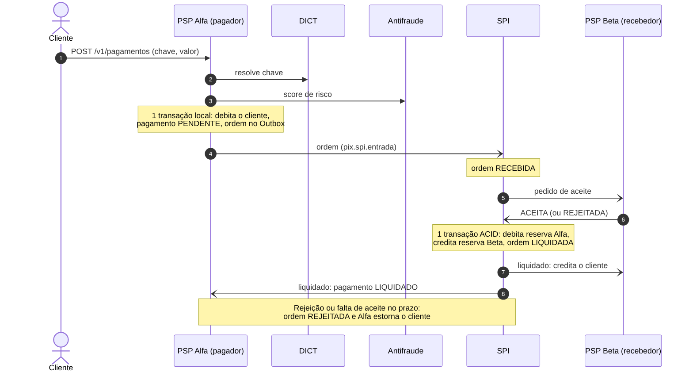

<!-- _class: capa -->
<!-- _paginate: false -->

# Urubu do Pix

## Pagamentos instantâneos distribuídos

O meme promete multiplicar o dinheiro. O sistema garante que nenhum centavo é criado ou perdido.

Projeto 02 · Engenharia de Sistemas Distribuídos 2026.2
Deivison · Giancarlo · Herlan

<!-- Deivison (20 s): apresenta o grupo e o mote. -->

---

<div class="quem">Deivison · ~1 min</div>

## O problema

Um Pix atravessa **três participantes independentes**, cada um com o próprio banco de dados:

**banco pagador → liquidante central (SPI) → banco recebedor**

- Precisa terminar em **segundos**
- Com **quedas, timeouts, partições de rede e mensagens repetidas**
- E a **soma dos saldos não pode mudar**

Não existe transação distribuída (2PC) entre instituições. **A garantia tem de vir da arquitetura.**

<!-- Deivison: enfatizar que o problema não é "fazer uma API de pagamento", é manter um invariante global sem transação global. -->

---

<div class="quem">Deivison</div>

## Critérios de sucesso (proposta aprovada)

| # | Critério | Meta |
|---|---|---|
| C1 | Conservação | soma dos saldos idêntica antes e depois de qualquer cenário |
| C2 | Idempotência | 0 liquidações duplicadas em 10.000 reenvios |
| C3 | Desempenho | p99 ≤ 2 s a 300 pagamentos/s por 10 min |
| C4 | Resiliência | rede cortada sob carga: 100% em estado final ≤ 30 s após reconectar |
| C5 | Degradação | antifraude fora: circuit breaker abre em ≤ 5 s |
| C6 | Segurança | 100% das chamadas sem credencial recusadas; varredura bloqueada |
| C7 | Deployment | canary do antifraude com rollback automático |

<!-- Cada decisão que vamos mostrar está amarrada a um destes critérios. -->

---

<div class="quem">Deivison</div>

## C4 nível 1: contexto



<!-- O ecossistema inteiro (bancos, SPI, DICT, antifraude) é o nosso sistema. Fora dele: clientes, operação, ferramentas de teste e o GitHub, que entrega as imagens assinadas. -->

---

<div class="quem">Deivison</div>

## C4 nível 2: containers



<!-- Cinco serviços Go, quatro Postgres, Redis, Redpanda, Envoy. Síncrono só onde precisa de resposta imediata (DICT, antifraude); o que mexe em saldo anda por mensagem. Tracejado = P03. -->

---

<div class="quem">Deivison · ADR-0001 · ~1 min</div>

## SAGA orquestrada pelo SPI + Outbox



- Liquidação entre reservas: **uma transação ACID** no SPI
- Débito e mensagem na **mesma transação** (Outbox): nunca divergem
- Recebedor só credita **depois** da liquidação: aceite atrasado não cria dinheiro

<!-- Alternativas descartadas: 2PC (bloqueia e não existe entre bancos), coreografia (estado espalhado, ninguém é dono do prazo). Mudança em relação à proposta: o SPI pede o aceite antes de liquidar, como no Pix real. -->

---

<div class="quem">Giancarlo · ADR-0002 · ~1,5 min</div>

## Mensageria: Redpanda, uma caixa de entrada por participante

| Tópico | Publica | Consome |
|---|---|---|
| `pix.spi.entrada` | PSPs | SPI |
| `pix.psp.<ISPB>.entrada` | SPI | só aquele banco |
| `*.dlq` | consumidor, após os retries | operação |

- **Chave = EndToEndId** → mensagens do mesmo pagamento na mesma partição, em ordem
- **Pelo menos uma vez** + consumidor idempotente (Inbox), sem depender de exactly-once
- Por que não RabbitMQ? Sem releitura do log. Kafka? Mesma API, mas JVM e mais pesado

<!-- Giancarlo: explicar que um banco nunca lê mensagens de outro, como no SPI real. -->

---

<div class="quem">Giancarlo · ~1 min</div>

## Idempotência ponta a ponta

**EndToEndId** no formato do Pix: `E` + ISPB + data/hora UTC + 11 caracteres

`E10000001202611041607aB3dE9fK2Lm`

Três barreiras contra débito ou crédito em dobro:

1. `ordens.end_to_end_id` é **chave primária** no SPI
2. `UNIQUE (end_to_end_id, tipo)` nos **lançamentos** de cada banco
3. **Inbox** (`mensagens_processadas`) na mesma transação do efeito

Valores sempre em **centavos inteiros**: `float` perde centavos em somas.

<!-- Giancarlo: mostrar internal/dominio/e2eid e o esquema deploy/postgres/psp/01-esquema.sql. -->

---

<div class="quem">Herlan · ADR-0003 · ~1,5 min</div>

## Zero Trust na borda

**Envoy** é a única porta de entrada:

- Só os **PSPs** têm rota; SPI, DICT, antifraude e auditor ficam invisíveis
- Rate limit global (1.000 req/s) e **10 req/s em consulta de chave** contra varredura do DICT
- `/metrics` bloqueado na borda
- Health check ativo em `/readyz` e ejeção de instância com erros 5xx seguidos

**No P03:** Keycloak (OIDC/JWT) validado no Envoy, autorização no OPA, mTLS entre serviços

<!-- Herlan: a varredura de chaves é um golpe real do Pix, usado para levantar dados pessoais. -->

---

<div class="quem">Herlan · ~1 min</div>

## Segmentação de rede e containers endurecidos

| Rede | Quem |
|---|---|
| `borda` | gateway, PSPs |
| `nucleo` | serviços e Redpanda |
| `db-*` (internas) | cada serviço **só com o próprio banco** |

- Um PSP **não alcança** o banco do outro, e nenhum banco é alcançável pela borda
- Imagem distroless sem shell, usuário sem privilégio, **somente leitura**, sem capabilities
- Verificado automaticamente no CI (com controle positivo)

---

<div class="quem">Herlan · ~1 min</div>

## Stack

| Camada | Escolha | Por quê |
|---|---|---|
| Serviços | **Go 1.26** | concorrência nativa, binário estático, pouca memória |
| Dados | **PostgreSQL 18**, um por serviço | ACID, `CHECK`/`UNIQUE` reforçam os invariantes |
| Mensageria | **Redpanda** (API Kafka) | log durável, ordem por chave, leve |
| Cache | **Redis 8** | cache-aside e limite por PSP no DICT |
| Borda | **Envoy** | rate limit, JWT e OPA nativos |
| Observabilidade | **Prometheus + Grafana** (Jaeger no P03) | p99 e taxa de erro |
| Testes (P03) | **k6, Toxiproxy, Testcontainers** | carga, caos, integração real |

---

<div class="quem">Herlan · ADR-0004 · ~1,5 min</div>

## Pipeline DevSecOps

`push` / `PR` → **testes** (`-race`, cobertura) · **lint** (gosec) · **govulncheck** · **Trivy** (repo e imagens) · **SBOM** (Syft) · **fumaça** (Compose inteiro)

`main` → push no **GHCR** + **assinatura keyless com Cosign** + proveniência SLSA

Supply chain:
- Actions fixadas por **SHA**, não por tag
- **Dependabot** semanal (Go, imagens, actions)
- Permissões mínimas por job
- Uma imagem **distroless** para todos os serviços

<!-- Herlan: mostrar o CI verde no GitHub. No P03, Argo Rollouts no kind para o canary do antifraude (C7). -->

---

<div class="quem">Giancarlo · ADR-0005 · ~1,5 min</div>

## Auditor de invariantes e observabilidade

O auditor consulta APIs internas (não os bancos) e dá um **veredito objetivo** ao fim de cada teste:

1. Soma das reservas no SPI é constante
2. Por banco, em repouso: **clientes = reserva** (hoje: R$ 5.000,00 = R$ 5.000,00)
3. Nenhum EndToEndId liquidado duas vezes
4. Nenhuma ordem presa além do prazo + 30 s

Desde o primeiro commit: `/metrics` por rota, `/healthz` ≠ `/readyz`, logs JSON

<!-- Giancarlo: por que healthz não consulta o banco? Para o banco fora do ar não fazer o orquestrador reiniciar o serviço em loop. -->

---

<div class="quem">Giancarlo · ~1 min</div>

## Plano de testes

| Critério | Teste | Ferramenta |
|---|---|---|
| C1, C2 | 10.000 reenvios do mesmo EndToEndId + auditor | Testcontainers |
| C3 | 300 pagamentos/s por 10 min | k6 + Prometheus |
| C4 | corte SPI↔PSP por 60 s sob carga | Toxiproxy + auditor |
| C5 | antifraude derrubado sob carga | Compose + métricas |
| C6 | sem JWT, token expirado, certificado estranho, rajada de chaves | testes negativos |
| C7 | versão com 5% de erro | Argo Rollouts |

**Já roda hoje:** unitários (81–100% por pacote), lint, scanners e fumaça no CI

---

<div class="quem">Giancarlo · demo · ~1 min</div>

## Demonstração

```bash
cp .env.example .env
docker compose up -d --build --wait
./scripts/fumaca.sh
docker compose --profile observabilidade up -d   # Prometheus em :9090
```

- 13 containers saudáveis
- Gateway roteia, limita (429) e esconde o núcleo
- Bancos isolados por rede
- Tópicos e DLQs criados
- Invariante de conservação válido nos dados iniciais

<!-- Se a rede da sala falhar, mostrar a gravação ou o log do job "Teste de fumaça" no GitHub Actions. -->

---

<div class="quem">Deivison · ~1 min</div>

## Divisão e próximos passos (Projeto 03)

| Integrante | Frente | No P03 |
|---|---|---|
| Deivison | Liquidação, observabilidade | SAGA e liquidação atômica no SPI, Jaeger, k6 |
| Giancarlo | Bancos, mensageria, qualidade | API do PSP, Outbox, consumidores, DLQ, auditor, Toxiproxy |
| Herlan | Borda, segurança, entrega | DICT com cache, Keycloak/JWT, OPA, mTLS, antifraude, canary |

**12 padrões** mapeados nas 5 áreas · **5 ADRs** · C4 níveis 1 e 2 · ambiente e CI funcionando

---

<!-- _class: capa -->
<!-- _paginate: false -->

# Perguntas?

github.com/Deivison-Costaa/urubu-do-pix
