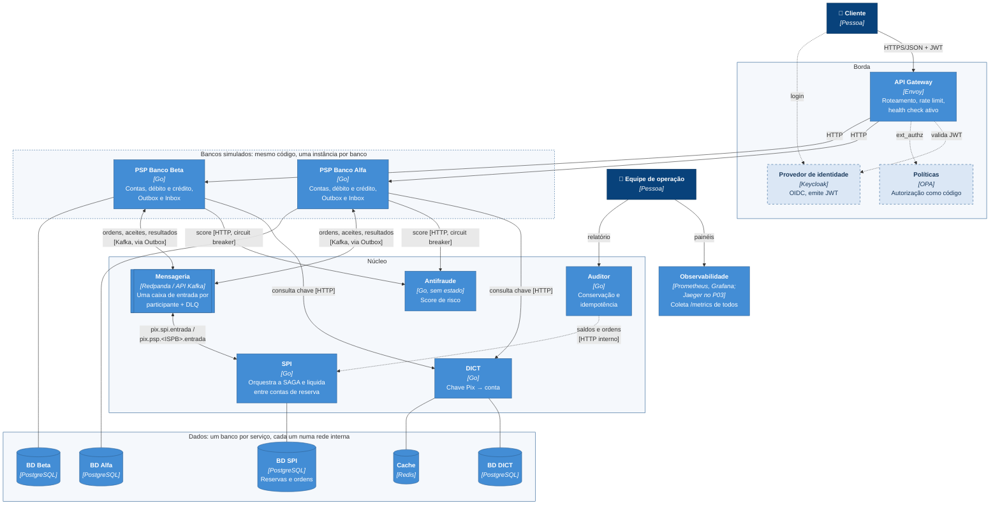
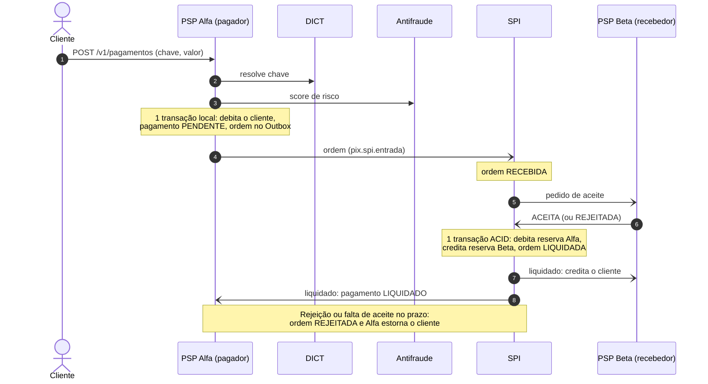

# C4 nível 2: containers

Cada serviço é um processo Go com banco próprio. A comunicação síncrona (HTTP) fica nas consultas que precisam de resposta imediata (chave no DICT, score no antifraude). As etapas do pagamento que mexem em saldo andam por mensagens no Redpanda, gravadas antes num Outbox na mesma transação do saldo (ADR-0001 e ADR-0002).

Caixas claras com borda tracejada (Keycloak e OPA) e as setas tracejadas que chegam nelas entram no Projeto 03. O auditor também consulta os PSPs (seta omitida para não poluir o desenho).

## Containers

| Container | Tecnologia | Responsabilidade | Dados | Exposto na borda? |
|---|---|---|---|---|
| API Gateway | Envoy | Ponto único de entrada: roteamento por banco, rate limit global e por rota, health check ativo, bloqueio de `/metrics` | não | sim (porta 8080) |
| PSP (Alfa, Beta) | Go | Contas de clientes, débito e crédito, Outbox e Inbox; inicia o pagamento | PostgreSQL próprio | sim, via gateway |
| SPI | Go | Recebe ordens, consulta o aceite do recebedor, liquida de forma atômica e notifica os dois lados | PostgreSQL próprio | não |
| DICT | Go | Resolve chave Pix em conta; cache-aside e limite de consultas por PSP | PostgreSQL + Redis | não |
| Antifraude | Go | Score de risco por pagamento; sem estado, escala horizontalmente e recebe canary no P03 | não | não |
| Auditor | Go | Verifica conservação de saldo e ausência de liquidação duplicada | não (lê APIs) | não |
| Redpanda | Redpanda | Tópicos `pix.spi.entrada` e `pix.psp.<ISPB>.entrada`, com DLQ | log próprio | não |
| Observabilidade | Prometheus, Grafana | Coleta `/metrics` de todos os serviços e do gateway | séries temporais | só em 127.0.0.1 |
| Keycloak, OPA | (P03) | Identidade (OIDC/JWT) e autorização como código | — | — |

## Redes do Docker Compose

A segmentação aplica o Zero Trust já no ambiente local (ADR-0003):

| Rede | Quem participa |
|---|---|
| `borda` | gateway, PSPs |
| `nucleo` | PSPs, SPI, DICT, antifraude, auditor, Redpanda |
| `db-psp-alfa`, `db-psp-beta`, `db-spi`, `db-dict` (internas) | cada serviço com o seu banco; o DICT também com o Redis |
| `observabilidade` | todos os serviços, gateway, Prometheus e Grafana |

Um PSP não alcança o banco do outro PSP, e nenhum banco é alcançável pela borda. O teste de fumaça (`scripts/fumaca.sh`) verifica isso.

## Fluxo de um pagamento

O recebedor só credita o cliente depois da notificação de liquidação. Assim um aceite que chega atrasado, depois do prazo, não gera crédito sem dinheiro correspondente na reserva.
