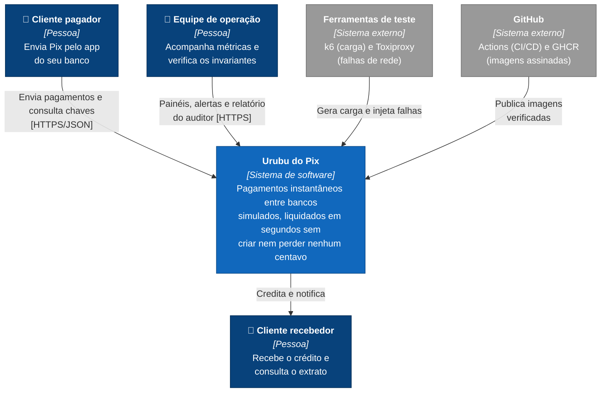

# C4 nível 1: contexto

O Urubu do Pix simula o ecossistema Pix inteiro numa só implantação: os bancos (PSPs), o liquidante central (SPI), o diretório de chaves (DICT) e o antifraude. Por isso o sistema aparece como uma caixa só neste nível. Quem está fora dele são as pessoas que pagam e recebem, a equipe que opera e audita, e as ferramentas de teste e de entrega.

## Elementos

| Elemento | Tipo | Responsabilidade |
|---|---|---|
| Cliente pagador | Pessoa | Inicia o pagamento informando a chave Pix do recebedor e o valor. |
| Cliente recebedor | Pessoa | Recebe o crédito na conta do seu banco. |
| Equipe de operação | Pessoa | Acompanha latência, erros e filas; roda o auditor depois de cada teste. |
| Urubu do Pix | Sistema | Resolve a chave, avalia o risco, debita, liquida e credita, mantendo a soma dos saldos. |
| Ferramentas de teste | Externo | Medem os critérios de sucesso C3 (desempenho) e C4 (resiliência). |
| GitHub | Externo | Executa o pipeline e guarda as imagens assinadas que o ambiente usa. |

O nível 2 abre a caixa do sistema: [c4-containers.md](c4-containers.md).
